  

# 💫 À propos

🎓 Étudiant en Bac 3 Sécurité des systèmes à **Hénallux**, orienté gouvernance, gestion des risques et conformité (GRC). 
📋 Je fais le lien entre les contrôles de sécurité et leur mise en œuvre : ISO 27001 / 27002, EBIOS RM, RGPD. 
🧪 Je m'entraîne sur TryHackMe, HackTheBox, RootMe et PicoCTF, et je publie mes writeups. 
🔎 **Je cherche un stage de 3 mois à partir de février 2027** en sécurité de l'information (GRC / ISO 27001).

# 💻 Compétences

# 🔧 Outils

# 🎓 Formation & certifications

# 🚀 Projets

## 🏰 Lab Active Directory : étude de risque et test de contrôles
*2026*

- Environnement isolé de 3 VM (Windows Server, Windows 11, Kali Linux) simulant une infrastructure d'entreprise
- Risque étudié : vol de credentials en mémoire (LSASS), détecté via Sysmon
- Mesures testées : durcissement par GPO (RunAsPPL, Protected Users) et validation de la remédiation

## 🚩 CTF et writeups
*2026*

- Pratique régulière sur TryHackMe, HackTheBox, RootMe et PicoCTF
- Writeups publiés sur [thewardenmaker.github.io](https://thewardenmaker.github.io), un site conçu et développé par mes soins
- Création d'une room TryHackMe originale (en cours)

# 🤝 Engagements

- **Délégué de classe** (2025 → 2027) : interface entre les étudiants et l'administration pédagogique
- **Conseil CISC, responsable partenariats** (2025 → 2026) : prise de contact et négociation avec des entreprises pour le sponsoring d'événements étudiants

# 📫 Me contacter

